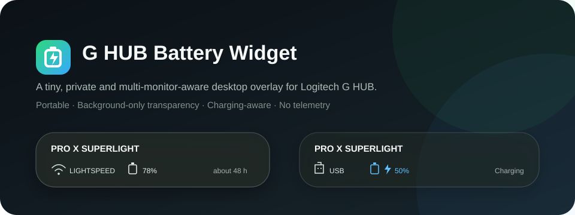
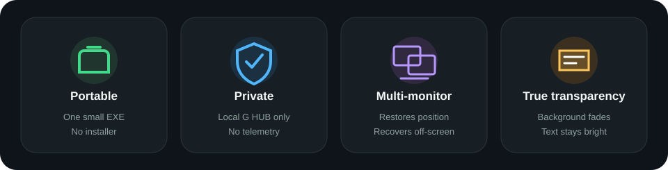
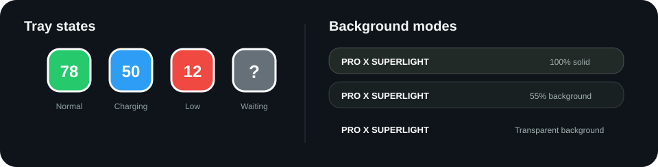

<p align="center">
  
</p>

<p align="center">
  <a href="README.md"><strong>English</strong></a> ·
  <a href="README.zh-TW.md">繁體中文</a>
</p>

<p align="center">
  
  
  
  
</p>

# G HUB Battery Widget

A tiny Windows desktop overlay for the battery level already reported by Logitech G HUB. It is designed for people who want a glanceable widget—not another device suite, service or installer.

The widget stays crisp while its background fades independently, reacts to USB charging within about five seconds, remembers its physical position across multiple monitors, and contains no telemetry or Internet update code.

<p align="center">
  
</p>

## Highlights

- **True background transparency** — choose 100%, 85%, 70%, 55%, or a fully transparent background while text and icons remain bright.
- **Charging-aware** — automatically switches between LIGHTSPEED and USB, with a charging indicator and blue battery state.
- **Multi-monitor recovery** — remembers physical screen coordinates and moves itself back on-screen after a monitor is disconnected or the layout changes.
- **Portable** — one small executable; no installer, driver or downloaded runtime package.
- **Private by design** — connects only to G HUB on `127.0.0.1`; no telemetry, analytics or remote network requests.
- **Desktop-friendly** — rounded card, drag positioning, edge snapping, always-on-top and optional mouse click-through.
- **Tray controls** — a high-contrast percentage icon, one-click show/hide, immediate refresh and optional start with Windows.

<p align="center">
  
</p>

## Requirements

- Windows 10 or Windows 11
- Logitech G HUB running in the background
- A Logitech device for which G HUB reports battery status
- .NET Framework 4.8, included with current Windows 10/11 installations

The current implementation was tested with a **PRO X SUPERLIGHT**. Other G HUB battery devices may work, but multi-device selection is not implemented yet.

## Download and use

1. Download `GHubBatteryWidget.exe` from the latest release.
2. Keep Logitech G HUB running and launch the executable—there is no installer.
3. Drag the widget to move it. Right-click the widget or tray icon for background opacity, topmost, click-through, refresh, screen positioning, startup and exit controls.
4. When click-through is enabled, use the tray icon to open the menu.

On first launch, the widget appears at the bottom-right of the monitor containing the mouse pointer. **Move to current screen's bottom-right** sends it to another monitor. If the saved display disappears, the widget automatically returns to a visible working area.

> Windows SmartScreen may warn about an unrecognized application because community builds are not code-signed. The source and reproducible build script are included so you can compile it yourself.

## Privacy and security

The application:

- connects only to `ws://127.0.0.1:9010`;
- sends read requests only to `/devices/list` and `/battery/{deviceId}/state`;
- does not upload device data or connect to remote hosts;
- does not read documents, browser data, credentials or clipboard contents;
- does not install a service or driver and does not request administrator privileges;
- stores only physical X/Y position, background opacity, topmost and click-through flags in a local `GHubBatteryWidget.ini`;
- writes its own quoted path to the current user's Run key only when **Start with Windows** is explicitly enabled.

Incoming local messages have a six-second timeout and a 1 MiB limit. Device identifiers and battery ranges are validated before use. See [SECURITY.md](SECURITY.md) for the trust boundary and reporting guidance.

## Build from source

No NuGet packages or downloaded dependencies are used. From Windows PowerShell:

```powershell
.\build.ps1
```

The script uses the .NET Framework C# compiler already present on Windows and writes `dist\GHubBatteryWidget.exe`.

## Protocol references and acknowledgements

The application code, interface and artwork in this repository were written independently. No source files or binary components from these projects are included. Their public documentation and implementations were consulted to confirm G HUB's local WebSocket behavior:

- [bmrussell/LGBattery](https://github.com/bmrussell/LGBattery) — documented the `ws://localhost:9010` headers, device enumeration and battery endpoints (Apache-2.0).
- [andyvorld/LGSTrayBattery](https://github.com/andyvorld/LGSTrayBattery) — an earlier open-source G HUB/HID battery monitor used as a behavioral reference (GPL-3.0).

### Related project

[HeyOkay/HaloBattery](https://github.com/HeyOkay/HaloBattery) is a mature multi-vendor system-tray battery monitor that talks directly to HID devices and does not require G HUB. Choose HaloBattery when broad device support and tray-only operation matter more than a desktop overlay.

Logitech, G HUB, LIGHTSPEED and product names are trademarks of Logitech. This independent project is not affiliated with or endorsed by Logitech.

## License

Released under the [MIT License](LICENSE).
